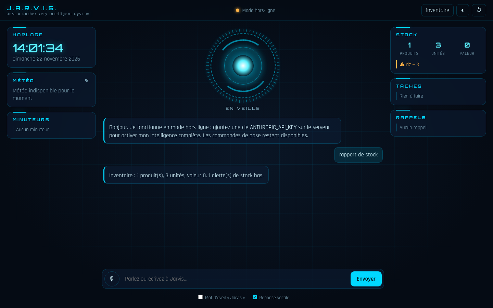

# J.A.R.V.I.S. — assistant personnel multifonction

Assistant vocal façon « Iron Man » qui tourne dans le navigateur, avec Claude comme cerveau.
Interface HUD (réacteur animé, visualiseur audio), commande vocale en français, réponses parlées,
et une vraie **gestion de stock** intégrée (le cœur du projet Moriba Stock Manager).



## Ce qu'il sait faire

| Domaine | Exemples de commandes |
|---|---|
| 📦 Stock | « Ajoute 50 sacs de riz à 250 000 l'unité, seuil d'alerte 10 », « Vends 3 riz », « Qu'est-ce qui est en rupture ? », « Rapport de stock de la semaine », « Change le prix de l'huile à 18 000 » |
| ✅ Tâches / 📝 Notes | « Ajoute la tâche appeler le comptable, priorité haute », « Note : code du portail 4512 », « Mes tâches » |
| ⏰ Rappels / minuteurs | « Rappelle-moi demain à 9 h de passer à la banque », « Minuteur 5 minutes » (alerte vocale + notification) |
| 🧠 Mémoire | « Retiens que mon fournisseur principal s'appelle Bah Import » |
| 🌦 Météo / 🕐 Heure | « Météo à Conakry », « Quelle heure est-il à Paris ? » |
| 🔢 Calcul / conversions | « Combien font 17,5 % de 2 400 000 ? », « 1250 € en francs guinéens », « 30 °C en Fahrenheit » |
| 🌍 Savoir / actu | « Actualités du jour » (recherche web), « Qui était Sékou Touré ? » (Wikipédia) |
| 🖥 Navigateur | « Ouvre YouTube », « Joue du Mory Kanté sur YouTube », « Itinéraire vers l'aéroport », « Passe en thème clair » |
| ⚙️ Système | « État du système » |

Interface : bouton micro ou **barre d'espace maintenue** (push-to-talk), mot d'éveil **« Jarvis »**
optionnel (écoute continue), réponse vocale phrase par phrase, `Échap` pour couper.
Tableau de bord en direct : horloge, météo, stock (valeur, alertes), tâches, rappels, minuteurs, inventaire complet.

## Installation

Prérequis : Node.js 22.9+ et Chrome ou Edge (pour la reconnaissance vocale).

```bash
cd jarvis
npm install
cp .env.example .env      # puis mettez votre clé ANTHROPIC_API_KEY
npm start
```

Ouvrez http://localhost:3000 et autorisez le micro.

**Sans clé API**, Jarvis démarre en *mode hors-ligne* : il comprend toujours les commandes de base
(heure, météo, calculs, notes, tâches, rappels, minuteurs, entrées/sorties de stock, rapport…).
Avec la clé, il comprend le langage naturel, enchaîne plusieurs outils et fait des recherches web.

## Configuration (`.env`)

| Variable | Défaut | Rôle |
|---|---|---|
| `ANTHROPIC_API_KEY` | — | Clé API Claude (console.anthropic.com) |
| `JARVIS_USER_NAME` | `Monsieur` | Comment Jarvis vous appelle |
| `JARVIS_TIMEZONE` | fuseau du système | Pour les rappels et l'heure |
| `JARVIS_EFFORT` | `low` | Profondeur de réflexion : `low` (rapide), `medium`, `high` |
| `JARVIS_MODEL` | `claude-opus-5-5` | Modèle Claude |
| `PORT` | `3000` | Port HTTP |

Les données (stock, notes, tâches, rappels, mémoire) sont stockées en JSON dans `jarvis/data/` (non versionné).

## Architecture

```
jarvis/
├── server.js     # Express + boucle Claude en streaming (SSE), outils, repli hors-ligne
├── tools.js      # 19 outils : stock, notes, tâches, rappels, mémoire, météo, devises, Wikipédia…
├── offline.js    # Compréhension par règles quand Claude n'est pas joignable
├── calc.js       # Évaluateur mathématique sûr (sans eval)
├── store.js      # Persistance JSON atomique
└── public/       # Interface HUD : index.html, style.css, app.js (voix, visualiseur, tableau de bord)
```

- Les réponses sont diffusées en streaming ; la synthèse vocale démarre dès la première phrase.
- Les appels d'outils d'un même tour s'exécutent en parallèle.
- La recherche web est faite par l'outil serveur `web_search` de Claude.
- Si le modèle décline une demande, l'API bascule automatiquement sur le modèle de repli recommandé (`fallbacks: "default"`).
- Météo : Open-Meteo, devises : open.er-api.com, savoir : Wikipédia — tous gratuits, sans clé.
